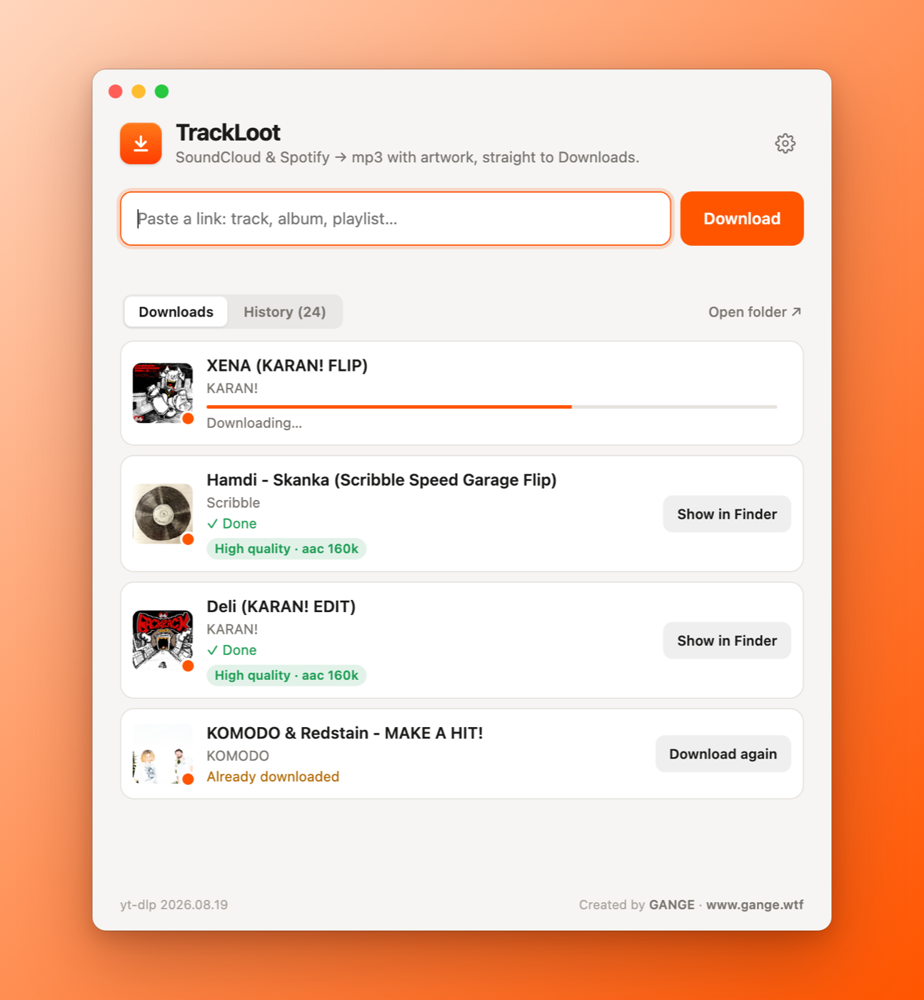

<p align="center">
  
</p>

<h1 align="center">TrackLoot</h1>

<p align="center">
  Paste a SoundCloud, YouTube or Spotify link, get a tagged mp3 with artwork in your Downloads folder.<br>
  A tiny desktop app for macOS and Windows, built with Tauri.
</p>

<p align="center">
  <a href="https://github.com/angelocipullo/trackloot/releases/latest"><b>⬇ Download for macOS &amp; Windows</b></a>
</p>

<p align="center">
  
</p>

---

## Features

- **SoundCloud, YouTube & Spotify**: tracks, albums, playlists and sets.
- **Artwork and tags embedded**: title, artist, cover (and album + track number for albums).
- **Real quality check**: every download gets a *High / Medium / Low* label based on the source bitrate **and** a spectral analysis of the file, so a 128 kbps rip re-encoded to 320 is still flagged as low quality.
- **BPM**: every track gets its tempo, shown in the app and written to the mp3's BPM tag (read by Rekordbox, Serato, Music…). It's estimated offline from the audio, no online service needed.
- **No duplicates**: a local history remembers what you already downloaded. Re-pasting a link tells you it's already there; playlists and sets skip the tracks you already have.
- **Clipboard watch**: copy a link anywhere and TrackLoot offers to download it (or downloads it straight away, if you turn on auto-download).
- **Drag & drop**: drop a link from your browser or the Spotify app onto the window.
- **Nothing else to install**: on first launch TrackLoot downloads the tools it needs ([yt-dlp](https://github.com/yt-dlp/yt-dlp), [ffmpeg](https://ffmpeg.org), [Deno](https://deno.com)) with one click, and updates yt-dlp from Settings.
- **Light**: ~6 MB installer, uses the system WebView, light and dark mode.

## How it works

| Source | What happens |
|---|---|
| **SoundCloud** | The original audio stream is downloaded with yt-dlp, converted to mp3 and tagged. |
| **YouTube** | Same as SoundCloud, for videos, playlists and YouTube Music. Titles like *Artist - Song (Official Video)* become artist *Artist* and title *Song*, and the thumbnail is cropped to a square cover. A video link that also carries a playlist (`watch?v=…&list=…`) downloads just that video. |
| **Spotify** | Spotify audio is DRM-protected, so TrackLoot reads the title, artists, length and artwork from Spotify's public embed page (no account or API key needed), finds the matching song on YouTube and tags the mp3 with Spotify's metadata. |

To pick the right YouTube match, TrackLoot compares the length of the top 8 results with the Spotify length, and penalises results tagged *live*, *cover*, *remix*, *slowed*, *sped up* and similar (unless the Spotify title has those words too). If the chosen version's length differs from Spotify's by more than 5 seconds, you get a "check version" warning.

### Quality check

After each download, TrackLoot runs ffmpeg to measure the energy above 15, 16.5 and 18.5 kHz. Lossy encoders cut the high frequencies: a 128 kbps mp3 stops at about 16 kHz, whatever bitrate it is re-encoded to later. That cutoff is combined with the source bitrate (opus and aac count as ~1.5× an mp3 of the same bitrate):

| Label | Meaning |
|---|---|
| **High** | Full frequency range and a good source bitrate |
| **Medium** | Slightly limited range or bitrate |
| **Low** | Typical of 128 kbps-or-lower sources |
| **Very low** | Heavily filtered audio |

Hover the label to see the details: cutoff, source codec and bitrate, and the final file's bitrate.

### BPM

TrackLoot finds where the beats hit (sudden rises in the spectrum's energy) and looks for the period that repeats the most, between 70 and 180 BPM. Results are usually exact for electronic music and within ±1 BPM for songs played live. Like any tempo detector it can land on half or double the tempo for some songs: e.g. a 159 BPM song can be shown as 80.

## Download

Grab the latest installer from the [**Releases**](../../releases/latest) page:

| System | File |
|---|---|
| **macOS 11+** (Apple Silicon & Intel) | `TrackLoot_x.y.z_universal.dmg` |
| **Windows 10/11** | `TrackLoot_x.y.z_x64-setup.exe` (or the `.msi`) |

On first launch, click **Install** in the *One-time setup* box: TrackLoot downloads yt-dlp, ffmpeg and Deno into its own folder (~120 MB on macOS, ~150 MB on Windows). If you already have them installed (e.g. with Homebrew), TrackLoot uses yours and skips this step.

> [!NOTE]
> The builds aren't signed with a paid Apple/Microsoft certificate yet, so the first launch needs one extra step.
>
> **macOS**: if it says the app is damaged or can't be opened, run once in Terminal:
> ```bash
> xattr -dr com.apple.quarantine /Applications/TrackLoot.app
> ```
> **Windows**: if SmartScreen says "Windows protected your PC", click **More info → Run anyway**.

## Build from source

Prerequisites: [Rust](https://rustup.rs), Node.js 18+, plus Xcode Command Line Tools on macOS or the [Tauri prerequisites](https://v2.tauri.app/start/prerequisites/) on Windows.

```bash
git clone https://github.com/angelocipullo/trackloot.git
cd trackloot
npm install
npm run build        # installer in src-tauri/target/release/bundle/
```

For development (opens the app in debug mode and rebuilds when you change the code):

```bash
npm run dev
```

### Releasing a new version

Releases are built by GitHub Actions ([release workflow](.github/workflows/release.yml)) every time you push a tag starting with `v`.

```bash
git commit -am "Describe the changes"
git push
git tag v1.1.0
git push origin v1.1.0
```

What happens next (about 5 minutes, follow it in the **Actions** tab):

1. Two builds run in parallel: one on macOS, one on Windows.
2. The app version is taken from the tag (`v1.1.0` → `1.1.0`), so you don't need to bump it in `tauri.conf.json` or `Cargo.toml` by hand.
3. A GitHub release named *TrackLoot v1.1.0* is created, with download instructions and these files:

| File | For |
|---|---|
| `TrackLoot_x.y.z_universal.dmg` | macOS, Apple Silicon and Intel |
| `TrackLoot_x.y.z_x64-setup.exe` | Windows installer (recommended) |
| `TrackLoot_x.y.z_x64_en-US.msi` | Windows, for managed installs |
| `TrackLoot_universal.app.tar.gz` | macOS app as an archive, for scripts and updaters |

**If a build fails**, fix the problem, then delete the release and the tag and push the tag again on the new commit:

```bash
gh release delete v1.1.0 --yes
git push origin :refs/tags/v1.1.0
git tag -f v1.1.0
git push origin v1.1.0
```

Builds are not code-signed (that needs a paid Apple Developer account and a Windows certificate), which is why users see the warnings described in [Download](#download).

## Usage

1. Open TrackLoot.
2. Paste a SoundCloud or Spotify link (track, album, playlist or set) and press **Download**. You can also drop the link onto the window, or just copy it while clipboard watch is on.
3. The mp3 lands in your Downloads folder as `Artist - Title.mp3`.

The **History** tab lists everything you downloaded, with its quality. The ✕ next to a track removes it from the history, so you can download it again.

In **Settings** (the gear icon) you'll find clipboard watch, auto-download and the yt-dlp version, with an update button.

### Where things are stored

| What | macOS | Windows |
|---|---|---|
| Downloads | `~/Downloads` | `%USERPROFILE%\Downloads` |
| History | `~/Library/Application Support/it.angelocipullo.trackloot/history.json` | `%APPDATA%\it.angelocipullo.trackloot\history.json` |
| Tools installed by the app | `…/it.angelocipullo.trackloot/bin/` | `%APPDATA%\it.angelocipullo.trackloot\bin\` |

TrackLoot puts its own `bin` folder first on the `PATH`, so the tools it installed win over system ones; anything it didn't install comes from your system.

### Command-line mode

Handy for testing and scripting (macOS). It runs a download without opening the window and prints the result as JSON:

```bash
/Applications/TrackLoot.app/Contents/MacOS/trackloot --cli "<link>" [--force]
```

`--force` downloads the track again even if it's already in the history.

## Project structure

```
trackloot/
├── ui/index.html            # the whole interface (HTML/CSS/JS, no build step)
├── src-tauri/
│   ├── src/main.rs          # backend: downloads, Spotify matching, history, quality check
│   ├── src/tools.rs         # downloads/updates yt-dlp, ffmpeg and Deno
│   ├── tauri.conf.json      # window and bundle config
│   └── icons/               # app icons (generated from icon.png)
├── .github/workflows/       # release workflow (installers on tag push)
└── icon.png                 # 1024×1024 source icon
```

To regenerate the icons after changing `icon.png`:

```bash
npx tauri icon icon.png
```

## Known limitations

- Spotify audio comes from YouTube, so quality is capped by YouTube's stream (usually opus ~130 kbps, labelled *High*).
- Obscure edits or bootlegs on Spotify may match the wrong YouTube upload: check the warning and the length.
- Very long Spotify playlists may stop at the first 50–100 tracks, because that's all the public embed page shows.
- SoundCloud Go+ exclusive tracks only give a 30-second preview.
- The Windows build is produced by CI and hasn't been tested as much as the macOS one.

## Disclaimer

TrackLoot is meant for downloading music you have the right to download: free downloads, your own uploads, Creative Commons tracks, content you have permission for. Respect artists' rights and the terms of service of SoundCloud, Spotify and YouTube. The authors are not responsible for how this tool is used.

## Credits

Built on [yt-dlp](https://github.com/yt-dlp/yt-dlp), [ffmpeg](https://ffmpeg.org) and [Tauri](https://tauri.app).

## License

[MIT](LICENSE)

---

<p align="center">Created by <a href="https://www.gange.wtf"><b>GANGE</b></a> · <a href="https://www.gange.wtf">www.gange.wtf</a></p>
